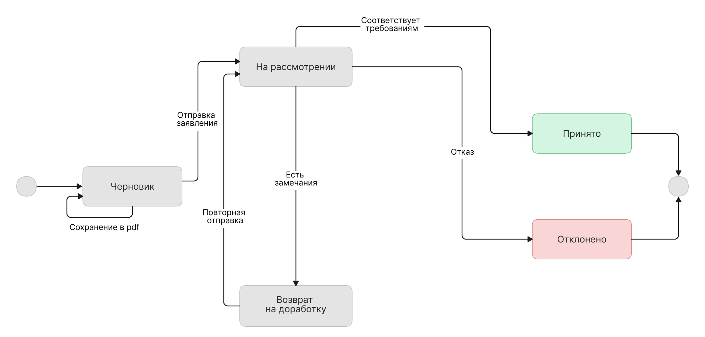

> **Дисклеймер:** Материал подготовлен в демонстрационных целях и отражает подход автора к проектированию. Описанные процессы и артефакты не претендуют на точность воспроизведения какой-либо информационной системы. Все совпадения с реальными системами случайны.
 
# **Электронная подача заявления на получение финансирования**
 
**Проблема:** Пользователи подавали заявления на получение целевого финансирования (ЦФ) на бумаге. Возникали проблемы с ошибками в заявлениях, неполными комплектами документов в заявлениях и сложности в коммуникациях при повторной подаче заявлений.
 
**Решение:** Перевести подачу заявлений в электронный вид через систему оказания услуг (СОУ), снизить число ошибок за счёт предзаполнения из внешней системы аутентификации и авторизации (ВСАА) и проверок на уровне формы, предоставить возможность правок конкретного шага заявления при повторной подаче.
 
**Результат:** Процесс подачи заявления переведён в цифровой вид. По сравнению с данными прошлого года доля возвратов заявлений на доработку сократилась на 15%, время подачи – на 35%.
 
# **1. Бизнес-требования**
 
> В разделе зафиксированы бизнес-правила подачи заявления: какие данные поступают из ВСАА, какие поля заявитель обязан заполнить и какие документы предоставить, какие решения может принять распорядитель средств.
> 
> **БТ-1.** Поля, полученные из ВСАА, недоступны для редактирования в форме. Данные заявителя можно изменить через личный кабинет в СОУ.
> 
> **БТ-2.** Другие обязательные к заполнению поля:
> - место выдачи документа, удостоверяющего личность заявителя
> - данные о регистрации: тип регистрации, адрес регистрации, документы, подтверждающие регистрацию
> - дополнительные сведения: тип обращения за финансированием, наименование целевого учреждения
> 
> **БТ-3.** Обязательные к загрузке документы:
> - данные о постоянной регистрации из паспорта / свидетельство о временной регистрации
> - документы, подтверждающие право на получение ЦФ
> 
> **БТ-4.** Распорядитель средств принимает заявление, либо возвращает его на доработку с указанием причины и шагов для исправления в рамках того же заявления.
> 
> *Диаграмма BPMN процесса TO-BE (ссылка)*
 
# **2. Основной и альтернативные сценарии использования**
 
| **Поле** | **Значение** |
| :--- | :--- |
| Актор | Заявитель |
| Предусловие | Заявитель аутентифицирован через ВСАА, имеет документы, подтверждающие право на получение ЦФ |
| Постусловие (успех) | Заявление зарегистрировано и направлено в распорядитель средств; заявитель получит уведомление о результате на e-mail |
| Постусловие (отказ/доработка) | Заявление возвращено на доработку с указанием причины и шага; заявитель вносит правки и подаёт заявление повторно |
| Основной сценарий использования (СИ-1) | 1. Заявитель открывает форму заявления. 2. СОУ получает из ВСАА и предзаполняет ФИО, дату рождения, пол, СНИЛС, паспортные данные, номер телефона, email (шаги 1-3). 3. Заявитель дополняет незаполненные поля: место рождения, место выдачи паспорта. 4. Заявитель указывает тип регистрации и прикладывает подтверждающий документ (шаг 4). 5. Заявитель указывает адрес постоянной регистрации на территории РФ. 6. Заявитель заполняет дополнительные сведения (шаг 5):  - социальный статус (необязательно),  - тип обращения за финансированием — первичное или вторичное (обязательно),  - целевое учреждение (обязательно) 7. Заявитель загружает обязательные документы с устройства, или из Личного кабинета заявителя, при необходимости добавляет дополнительные документы (шаг 6). 8. Заявитель подтверждает достоверность сведений (шаг 7). 9. Заявитель нажимает «Отправить заявление». 10. СОУ регистрирует заявление, направляет его в распорядитель средств и отображает его статус. 11. Распорядитель средств рассматривает заявление и принимает решение. 12. СОУ направляет заявителю уведомление о результате на e-mail. |
| Альтернативные сценарии | **A1. Не заполнены обязательные поля** A1a. Обязательное поле не заполнено (вводится самим заявителем — например, место выдачи паспорта). СОУ подсвечивает поле, блокирует переход, заявитель вводит значение. A1b. Поле, предзаполняемое из ВСАА, пришло пустым. СОУ блокирует переход и показывает инструкцию: обновить данные в личном кабинете в ВСАА и авторизоваться в СОУ заново. **A2. Не загружен обязательный документ** Под кнопкой загрузки появляется подсказка «Добавьте документы», переход блокируется. Применяется к документу о регистрации (шаг 4) и к документам для обоснования(шаг 6). **A3. Попытка отправки заявления без подтверждения достоверности** Кнопка «Отправить заявление» неактивна до отметки чекбокса о подтверждении достоверности сведений. **A4. Заявитель сохраняет черновик** Вместо отправки заявитель нажимает «Сохранить черновик в pdf». Формируется pdf-файл, заявление не отправляется и остаётся в статусе «Черновик». **A5. Ошибка аутентификации в ВСАА** ВСАА не может завершить аутентификацию, показывает ошибку входа, форма не открывается. **A6. Возврат на доработку** Распорядитель средств возвращает заявление с указанием причины и конкретного шага(ов) для исправления. Заявитель получает уведомление на e-mail, открывает заявление по ссылке — СОУ показывает шаг, на котором нужно внести изменения, остальные данные сохранены. После исправления заявитель повторно отправляет заявление (возврат к п.9 основного сценария). |
 
# **3. Требования**
 
## **3.1. Функциональные требования**
 
> Каждое требование имеет идентификатор, источник и приоритет; проверяется критериями приёмки из раздела 7.
 
| **N** | **Требование** | **Источник** | **Приоритет** |
| :--- | :--- | :--- | :--- |
| ФТ-1 | Система предзаполняет ФИО, дату рождения, пол, СНИЛС, паспортные данные заявителя, номер телефона, email из ВСАА; поля недоступны для редактирования в форме заявления | СИ-1 | Высокий |
| ФТ-2 | Система блокирует переход на следующий шаг, если обязательное поле текущего шага не заполнено или заполнено с ошибкой формата, подсвечивает это поле и выводит подсказку с пояснением о нужных действиях | СИ-1 (A1) | Высокий |
| ФТ-3 | Система требует загрузку документа, подтверждающего регистрацию и блокирует переход без него | СИ-1 (A2), БТ-3 | Высокий |
| ФТ-4 | Система требует загрузку обязательных документов на шаге 6 | СИ-1 (A2) | Высокий |
| ФТ-5 | Поле «Обращение за финансированием» — обязательный выбор из справочника: первичное, вторичное | СИ-1 | Средний |
| ФТ-6 | Система не позволяет отправить заявление без отметки о Достоверности сообщаемых сведений | СИ-1 (A3) | Высокий |
| ФТ-7 | Система позволяет сохранить черновик заявления в формате .pdf на любом шаге без отправки распорядителю средств | СИ-1 (A4) | Средний |
| ФТ-8 | Система сохраняет запись при каждой смене статуса заявления и предоставляет доступ к её просмотру в хронологическом порядке | СИ-1 | Средний |
| ФТ-9 | Система позволяет переводить заявление в статус «возврат на доработку» с обязательным указанием причины | СИ-1 (А6) | Высокий |
| ФТ-10 | При статусе «возврат на доработку» система направляет заявителю уведомление на e-mail с причиной и переходом к шагу заявления, где нужно внести изменения | СИ-1 (A6) | Высокий |
| ФТ-11 | При переходе по ссылке из письма о доработке система открывает заявление сразу на нужном шаге, сохраняя данные других шагов | СИ-1 (A6) | Высокий |
| ФТ-12 | После устранения замечаний заявитель повторно отправляет заявление с тем же ID | СИ-1 (A6) | Высокий |
| ФТ-13 | Система поддерживает загрузку документов как с устройства, так и из Личного кабинета заявителя | СИ-1 | Средний |
 
## **3.2. Нефункциональные требования**
 
> Требования к безопасности, аудиту, доступности и отказоустойчивости (НФТ-1…НФТ-5). Соответствие критериям приёмки приведено в разделе 7.
 
| **N** | **Тип** | **Требование** | **Источник** | **Приоритет** |
| :--- | :--- | :--- | :--- | :--- |
| НФТ-1 | Безопасность | Передача персональных данных между СОУ и ВСАА выполняется по защищённому каналу (протокол N) | СИ-1 | Высокий |
| НФТ-2 | Аудит | Система хранит историю статусов заявления: дата и время смены статуса, инициатор, причина возврата на доработку; записи не редактируются и не удаляются | СИ-1 (A6) | Высокий |
| НФТ-3 | Аудит | История хранится не менее N лет и доступна для выгрузки аудитору | СИ-1 (A6) | Высокий |
| НФТ-4 | Доступность | Уведомление о смене статуса заявления отправляется на e-mail в течение согласованного времени после смены статуса | СИ-1 | Низкий |
| НФТ-5 | Отказоустойчивость | При недоступности СОУ во время аутентификации система выводит сообщение об ошибке и сохраняет ранее введённые данные формы | СИ-1 (A5) | Средний |
 
# **4. Диаграмма состояний заявления**
 

 
| **Из статуса** | **В статус** | **Событие** | **Условие** | **Инициатор** |
| :--- | :--- | :--- | :--- | :--- |
| — | Черновик | Заявитель начал заполнение формы | — | Заявитель |
| Черновик | Черновик | Сохранение черновика | Нажата кнопка «Сохранить черновик в pdf» | Заявитель |
| Черновик | На рассмотрении | Отправка заявления | Все обязательные поля и документы заполнены, чекбокс подтверждения проставлен | Заявитель |
| На рассмотрении | Принято | Решение распорядителя средств | Заявление соответствует требованиям | Распорядитель средств |
| На рассмотрении | Возврат на доработку | Решение распорядителя средств | Обнаружены замечания | Распорядитель средств |
| Возврат на доработку | На рассмотрении | Повторная отправка | Заявитель исправил указанные шаги | Заявитель |
| На рассмотрении | Отклонено | Решение распорядителя средств | Принято решение об отказе | Распорядитель средств |
 
Финальный статус — «Принято», из каждого другого статуса есть выход. Статус «Отклонено» — в случае, если после возврата на доработку предоставленные данные не соответствуют требованиям.
 
# **5. Диаграммы последовательности**
 
Взаимодействие заявителя, СОУ и внешних систем в двух ключевых сценариях: открытие формы с предзаполнением из ВСАА и повторная подача после возврата на доработку.
 
## **5.1. Открытие формы и предзаполнение из ВСАА**
 
Заявитель входит через ВСАА, СОУ получает профиль и предзаполняет шаги 1–3. Показаны ветки ошибки аутентификации и пустого поля из СОУ.
 

 
## **5.2. Повторная подача после возврата на доработку**
 
Распорядитель средств возвращает заявление на доработку, заявитель получает письмо, открывает заявление сразу на нужном шаге, исправляет данные и повторно отправляет то же заявление.
 

 
## **5.3. Загрузка документа из Личного кабинета**
 
На шаге 4 или 6 заявитель выбирает файл из Личного кабинета: СОУ запрашивает список файлов, показывает его для выбора и прикрепляет выбранный файл к заявлению.
 

 
*ВСАА отвечает за аутентификацию и частичное заполнение профиля. Личный кабинет заявителя отвечает за хранение файлов. Сервис уведомлений направляет уведомление заявителю на email.*
 
# **6. Критерии приёмки**
 
## КП-01. Предзаполнение и защита данных ВСАА
 
**Трассировка:** ФТ-1
 
Given заявитель успешно аутентифицирован через ВСАА
When портал открывает форму заявления и получает профиль заявителя
Then ФИО, дата рождения, пол, СНИЛС, серия и номер паспорта, дата выдачи паспорта, номер телефона и e-mail заполнены данными, полученными из ВСАА
And поля, указанные в ФТ-1 как предзаполняемые из ВСАА, недоступны для редактирования в интерфейсе
And попытка изменить эти значения через API не приводит к сохранению изменённых значений
And API не сохраняет изменённые значения полей ВСАА
 
---
 
## КП-02. Обязательное поле не заполнено или имеет неверный формат
 
**Трассировка:** ФТ-2
 
Given заявитель находится на шаге, где есть обязательное поле, вводимое заявителем
And поле пустое либо значение не соответствует формату, заданному для этого поля
When заявитель нажимает «Далее»
Then переход на следующий шаг не выполняется
And некорректное поле визуально выделено
And рядом с полем отображается подсказка, объясняющая, что нужно исправить
And при серверной/API-валидации возвращается ошибка с указанием поля и кодом REQUIRED для пустого обязательного значения либо INVALID_FORMAT для неверного формата.
 
---
 
## КП-03. Пропуск необязательного поля
 
**Трассировка:** ФТ-2
 
Given поле «Место рождения» обозначено как необязательное
And поле оставлено пустым
When заявитель нажимает «Далее»
Then переход на следующий шаг выполняется успешно
And поле не помечается как ошибочное.
 
---
 
## КП-04. Документ, подтверждающий регистрацию
 
**Трассировка:** ФТ-3
 
Given заявитель заполняет сведения о регистрации
When заявитель пытается перейти дальше без документа, который обязателен для выбранного типа регистрации
Then переход блокируется
And под соответствующим блоком отображается подсказка «Добавьте документы»
And серверная проверка не позволяет отправить заявление без обязательного документа
And для временной регистрации отсутствие документа tempRegistrationDocumentId приводит к ошибке REQUIRED_IF_TEMP_REGISTRATION.
 
*Примечание: правило для постоянной регистрации следует утвердить отдельно (см. раздел 3).*
 
---
 
## КП-05. Обязательные документы
 
**Трассировка:** ФТ-4
 
Given заявитель находится на шаге 6
When заявитель пытается перейти дальше или отправить заявление, не загрузив один или несколько обязательных документов
Then система блокирует переход/отправку
And для каждого отсутствующего документа отображается подсказка «Добавьте документы» у соответствующего блока
And API возвращает ошибку валидации с указанием отсутствующего документа
And критерий проверяется отдельно для каждого документа
 
---
 
## КП-06. Обязательный тип обращения за финансированием
 
**Трассировка:** ФТ-5
 
Given заявитель находится на шаге 5
And поле «Обращение за финансированием» не заполнено
When заявитель нажимает «Далее» или отправляет заявление
Then переход/отправка блокируется
And поле выделяется и показывается подсказка «Выберите тип обращения»
And API возвращает ошибку REQUIRED для RequestType; HTTP-код соответствует контракту (для ошибок валидации отправки — 422)
And при заполнении допускаются только значения справочника: первичное (PRIMARY) или вторичное (SECONDARY).
 
---
 
## КП-07. Подтверждение достоверности сведений
 
**Трассировка:** ФТ-6
 
Given чекбокс подтверждения достоверности сведений не отмечен
When заявитель пытается отправить заявление
Then заявление не отправляется и не переходит в статус under_review
And интерфейс не позволяет выполнить отправку
And если запрос отправки всё же поступил в API без подтверждения, API возвращает 422 с кодом CONFIRMATION_REQUIRED.
 
---
 
## КП-08. Сохранение черновика в PDF
 
**Трассировка:** ФТ-7
 
Given заявление находится в статусе draft и заявитель находится на любом шаге формы
When заявитель выбирает «Сохранить черновик в PDF»
Then система формирует PDF-файл текущего черновика
And файл возвращается как содержимое ответа API формирования PDF
And заявление не отправляется распорядителю средств
And статус заявления остаётся draft
And данные заявления не изменяются в результате формирования PDF.
 
---
 
## КП-09. Запись истории при смене статуса
 
**Трассировка:** ФТ-8, НФТ-2
 
Given у заявления есть текущий статус
When статус заявления меняется
Then система создаёт новую запись истории для этого перехода
And запись содержит дату и время с часовым поясом, инициатора, предыдущий и новый статус
And при переходе в needs_revision запись содержит причину возврата
And записи истории доступны через API получения заявления в поле statusHistory
And записи возвращаются в хронологическом порядке от старых к новым.
 
---
 
## КП-10. Неизменяемость истории статусов
 
**Трассировка:** НФТ-2
 
Given запись истории статусов уже создана
When пользователь или клиент API пытается изменить либо удалить эту запись
Then операция не изменяет и не удаляет запись
And API отклоняет операцию согласно контракту; если для таких операций используется отдельный эндпойнт, он не должен предоставлять возможность изменения/удаления истории.
 
---
 
## КП-11. Возврат заявления на доработку
 
**Трассировка:** ФТ-9
 
Given заявление находится в статусе under_review
When уполномоченный сотрудник распорядителя средств возвращает заявление на доработку
Then система переводит заявление в статус needs_revision
And причина возврата обязательна и сохраняется в истории статусов
And если переход выполняется без причины, система отклоняет его и не меняет статус.
 
*Если процесс требует указания шага для исправления, шаг также должен быть передан и сохранён; обязательность этого поля нужно подтвердить владельцу продукта.*
 
---
 
## КП-12. Уведомление о возврате на доработку
 
**Трассировка:** ФТ-10, НФТ-4
 
Given заявление переведено в статус needs_revision и для возврата сохранены причина и шаг/шаги исправления
When система обрабатывает смену статуса
Then на e-mail заявителя отправляется уведомление
And уведомление содержит причину возврата и ссылку на заявление, ведущую к шагу, где нужно внести изменения
And отправка выполняется в пределах согласованного SLA после смены статуса
 
---
 
## КП-13. Переход из уведомления к нужному шагу
 
**Трассировка:** ФТ-11
 
Given заявление имеет статус needs_revision и в нём указано, какой шаг требует исправления
And заявитель получил уведомление со ссылкой на заявление
When заявитель открывает ссылку после аутентификации
Then открывается соответствующее заявление сразу на указанном шаге
And введённые ранее данные остальных шагов сохранены
And заявитель может просматривать и редактировать только те данные, которые доступны ему по правилам процесса.
 
---
 
## КП-14. Повторная отправка после доработки
 
**Трассировка:** ФТ-12
 
Given заявление находится в статусе needs_revision
And все обязательные замечания устранены
And обязательные поля и документы заполнены, подтверждение достоверности отмечено
When заявитель повторно отправляет заявление
Then система отправляет на рассмотрение то же заявление с прежним applicationId
And статус меняется на under_review
And в истории появляется новая запись о смене статуса
And повторная отправка не создаёт дубликат заявления.
 
*Если остаются открытые замечания, отправка блокируется и заявителю показываются неустранённые замечания.*
 
---
 
## КП-15. Загрузка документа с устройства
 
**Трассировка:** ФТ-13
 
Given заявитель находится на шаге, где доступна загрузка документа
When заявитель выбирает источник «Загрузить с устройства» и передаёт файл
Then файл прикрепляется к текущему заявлению
And документ появляется в списке документов с корректными documentId, documentTypeCode и source=upload
And API возвращает успешный ответ создания документа
 
---
 
## КП-16. Выбор документа из Личного кабинета
 
**Трассировка:** ФТ-13
 
Given в Личном кабинете заявителя доступен документ, подходящий для выбранного типа документа
When заявитель выбирает источник «Из Личного кабинета» и указывает идентификатор файла
Then документ связывается с текущим заявлением без повторной загрузки файла с устройства
And документ появляется в списке с source=personal_cabinet и соответствующим documentId/documentTypeCode
And если передан несуществующий или недоступный заявителю идентификатор файла, документ не прикрепляется и API возвращает ошибку.
 
---
 
## КП-17. Защищённая передача данных
 
**Трассировка:** НФТ-1
 
Given портал обменивается персональными данными с ВСАА
When устанавливается соединение для любого такого обмена
Then соединение использует протокол версии N или выше
And соединения с более низкой версией протокола N не устанавливаются.
 
---
 
## КП-18. Срок хранения истории и выгрузка аудитору
 
**Трассировка:** НФТ-3
 
Given история статусов заявления сформирована
When уполномоченный пользователь с ролью Аудитор запрашивает выгрузку истории
Then система предоставляет полную историю в пределах прав доступа аудитора
And записи истории сохраняются не менее N лет
And выгрузка выполняется вне API формы заявления, если отдельный API/эндпоинт аудита не будет добавлен в контракт
And обработка и предоставление выгрузки соответствуют утверждённым требованиям по защите персональных данных.
 
*Формат выгрузки, способ подтверждения срока хранения и конкретные ограничения доступа должны быть утверждены до тестирования.*
 
---
 
## КП-19. Уведомление о смене статуса в установленный срок
 
**Трассировка:** НФТ-4
 
Given статус заявления изменился и для этого события предусмотрено e-mail-уведомление
When система обрабатывает событие смены статуса
Then уведомление отправляется на e-mail заявителя не позднее утверждённого SLA
And в уведомлении указаны новый статус и ссылка на заявление
And факт отправки и время отправки доступны для проверки в журнале/системе доставки, если такой журнал предусмотрен архитектурой.
 
---
 
## КП-20. Недоступность ВСАА при аутентификации
 
**Трассировка:** НФТ-5
 
Given заявитель уже вводил данные формы, которые сохранены в черновике
When ВСАА недоступна или не отвечает во время аутентификации
Then портал показывает понятное сообщение об ошибке/временной недоступности
And не отображает ошибку как успешную аутентификацию
And ранее сохранённые данные черновика не теряются
And после восстановления доступа и повторной аутентификации заявитель может продолжить работу с сохранёнными данными.
 
---
 
## КП-21. Пустое обязательное поле, предзаполняемое из ВСАА
 
**Трассировка:** ФТ-1, ФТ-2
 
Given обязательное поле, получаемое из ВСАА, пришло пустым
When заявитель переходит к заполнению формы или пытается перейти дальше
Then отправка/переход блокируется
And система показывает инструкцию обновить данные в личном кабинете ВСАА и повторно пройти аутентификацию

